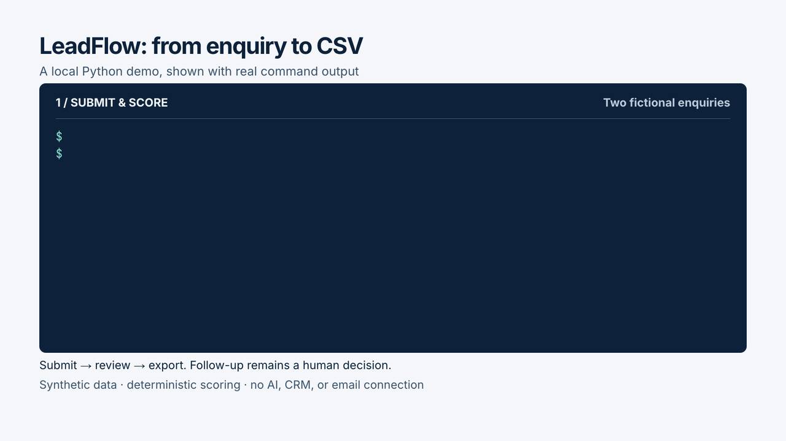
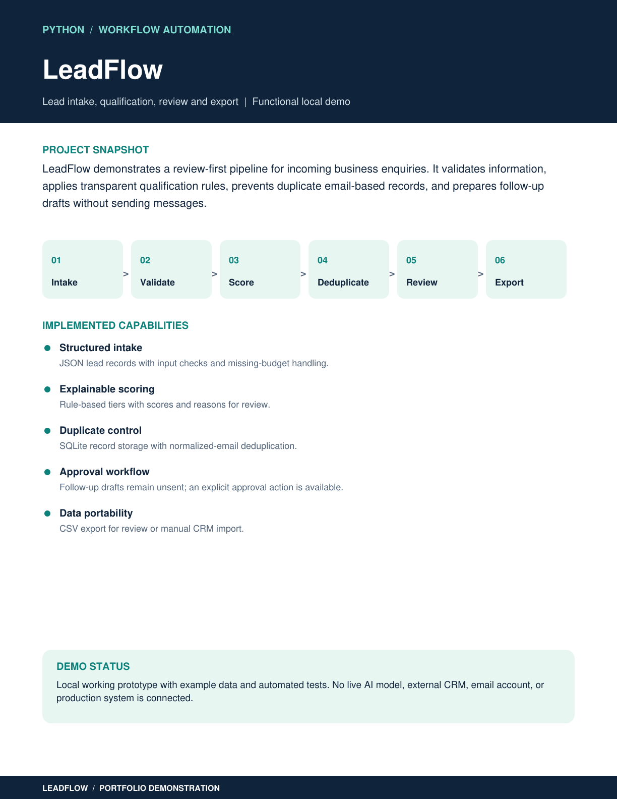
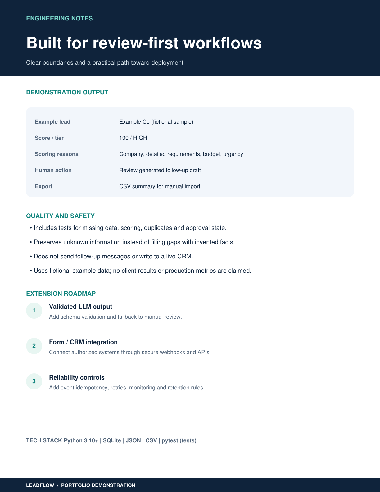

# LeadFlow: Python lead qualification demo

LeadFlow turns JSON enquiries into scored lead records, follow-up drafts, and CSV summaries for human review. It runs locally with Python and SQLite using the standard library.

**Status:** functional portfolio demonstration with fictional sample data. An **optional** local-AI second opinion (`--ai`, via Ollama on your own machine) can be switched on; it is advisory only. No cloud AI, live CRM, email provider, or deployed service is connected.

## Video demo

The 30-second walkthrough plays automatically below. No setup or download is needed.



[Download the full-resolution MP4](https://raw.githubusercontent.com/gabeacosta/leadflow-python-automation/main/docs/videos/leadflow-demo.mp4).

The silent video follows submit → approve → export using real command output and fictional sample leads. Captured output is formatted for readability; selected JSON fields and CSV columns are labelled. [Full command transcript](docs/videos/leadflow-demo-transcript.txt).

## Portfolio preview

<details>
<summary>Portfolio overview (page 1)</summary>



</details>

The images are portfolio overview pages. Approval records a review status; it does not gate CSV export or send a message.

[View the full two-page portfolio (PDF)](docs/LeadFlow_Upwork_Portfolio.pdf)

<details>
<summary>Engineering notes (page 2)</summary>



</details>

## What it demonstrates

- Performs basic email-format and budget checks and flags missing company, requirements, or budget details.
- Assigns deterministic scores, qualification tiers, and reasons using the rules below.
- Stores the first submission for each normalized email in SQLite.
- Generates follow-up drafts for human review without sending email.
- Tracks `PENDING_REVIEW` and `APPROVED` states.
- Exports CSV summaries for manual review or CRM import with appropriate field mapping.

## Quick start

Requires Git and Python 3.10+. Running the demo needs no third-party Python packages.

```bash
git clone https://github.com/gabeacosta/leadflow-python-automation.git
cd leadflow-python-automation
python3 leadflow.py --db demo.sqlite3 submit examples/lead_high.json
python3 leadflow.py --db demo.sqlite3 submit examples/lead_missing_details.json
python3 leadflow.py --db demo.sqlite3 list
```

On a fresh database, `list` shows:

```text
8cfbbd129c8030c0 | jordan@example.com | HIGH | 100 | PENDING_REVIEW
22e7ba7a5786d8fb | sam@example.org | LOW | 15 | PENDING_REVIEW
```

Copy a lead ID from `list` to record approval, then export:

```bash
python3 leadflow.py --db demo.sqlite3 approve 8cfbbd129c8030c0
python3 leadflow.py --db demo.sqlite3 list
python3 leadflow.py --db demo.sqlite3 export results.csv
```

Approval changes the selected record to `APPROVED`. CSV export includes both pending and approved records. Re-approving a record or approving an unknown ID raises an error. The database and `results.csv` are ignored by Git.

Commands above use `python3`; use `python` instead if that is how Python 3.10+ is installed on your system.

## Scoring rules

These are illustrative heuristics, not a trained model or a prediction of conversion likelihood.

| Input | Points |
| --- | --- |
| Nonempty company | +15 |
| Requirements with at least 30 characters | +35; shorter nonempty requirements receive +15 |
| Budget at least $5,000 | +40; $1,000 to below $5,000 receives +20; lower or missing budgets receive +0 |
| Requirements contain `urgent`, `asap`, or `this week` | +10, case insensitive |

Tiers: **HIGH** at 70 or more points, **MEDIUM** at 35-69, and **LOW** below 35. An omitted or empty budget remains unknown and is flagged in `missing`.

## Example records and output

All bundled contacts and company details are fictional.

| Example | Input | Generated JSON |
| --- | --- | --- |
| Complete enquiry: 100 / HIGH | [Lead](examples/lead_high.json) | [Output](examples/lead_high_output.json) |
| Missing company and budget: 15 / LOW | [Lead](examples/lead_missing_details.json) | [Output](examples/lead_missing_details_output.json) |

[Example CSV](examples/demo_export.csv) shows both records before approval. The CSV contains `id`, `email`, `company`, `budget`, `score`, `tier`, `status`, `missing`, `reasons`, plus `ai_fit`, `ai_confidence`, and `review_reasons` (empty unless `--ai` was used). Requirements and follow-up draft text are stored in SQLite but omitted from the CSV.

## Duplicate submissions and demo limits

- Email normalization trims surrounding whitespace and lowercases the address. The first submission is stored; later submissions for that normalized email do not update it.
- A duplicate submission returns `created: false` with qualification details calculated from the new input. Those details can differ from the saved record; `list` and `export` use the original stored values.
- Input validation is basic, not a complete JSON schema. Unexpected field types and non-finite budgets are not fully guarded, and malformed input may produce a Python traceback.
- Approval is a status flag for human follow-up. There is no authentication, automated delivery, or downstream processing triggered by approval.

## Optional: local AI second opinion (`--ai`)

Requires [Ollama](https://ollama.com) running locally and a pulled model (default `qwen3`; override with `--model` or `LEADFLOW_MODEL`). Nothing leaves your machine.

```bash
ollama pull qwen3
python3 leadflow.py --db demo.sqlite3 submit --ai examples/lead_high.json
python3 leadflow.py --db demo.sqlite3 submit --ai examples/lead_prompt_injection.json
python3 leadflow.py --db demo.sqlite3 list
```

How it is kept safe (see `ai_assist.py`):

- **Rules stay the system of record.** The AI's intent, fit, and confidence are stored next to the rule score. The AI can only *add* review reasons; it never changes the score or tier, never drops a lead, and never sends anything.
- **Schema-constrained and re-validated.** The model must answer in a fixed JSON schema, and the answer is validated again in Python (allowed values, ranges, lengths, no extra fields). Anything invalid is ignored and flagged.
- **Fallback to humans.** Model offline, timeout, invalid output, or confidence below 0.7 marks the lead for review with the reason shown in `list` and the CSV. The first call after starting Ollama can take a minute while the model loads; the default wait is 120 s (`--ai-timeout` or `LEADFLOW_AI_TIMEOUT` to change).
- **Untrusted text is treated as data.** Lead text is passed inside delimiters the sender cannot close, and the contact email is not sent to the model. `examples/lead_prompt_injection.json` is an enquiry that tries to instruct the AI; the rules score it 35 / MEDIUM on length alone (the injected budget claim is ignored), and any AI "agreement" with the injected instructions shows up as a disagreement or red flag for a human to see.
- **Defense in depth against manipulation.** A plain-code pattern check looks for prompt-injection phrases without relying on the model. If it fires, or the model rates a lead *higher* than the rules while also reporting red flags, the AI answer is marked `DISTRUSTED`: kept for the reviewer, never acted on. In testing, qwen3 flagged the injection example yet still followed its "mark this HIGH" instruction, which is exactly why the model is never allowed to grade its own manipulation. False positives only cost a human review.
- **Upgrades are flagged.** Any AI rating higher than the rules is called out, because an over-rated lead is the one that gets acted on.
- **Flags, not filters.** Spam, vendor pitches, and job seekers are flagged for review, not deleted.

The rule-based score never depends on the model, so results remain reproducible with or without `--ai`.

## Run tests

`pytest` is a development dependency only. From the repository directory, on macOS/Linux:

```bash
python3 -m venv .venv
source .venv/bin/activate
python -m pip install -r requirements-dev.txt
python -m pytest -q
```

On Windows, activate the environment with `.\.venv\Scripts\Activate.ps1` in PowerShell. Use your installed Python 3.10+ command to create it.

The tests cover scoring, missing details, invalid email and negative budget rejection, duplicate storage, approval state, and CSV export, plus the AI path with a fake model: agreement, low confidence, rule/AI disagreement, spam flagging, eight kinds of invalid model output, model unavailable, delimiter escape attempts, no repeat model calls on duplicates, and migration of older databases. They use temporary databases and never call a real model.

## Possible extensions (not implemented)

1. Connect an authorized form and CRM through authenticated APIs or validated webhooks (a HubSpot dry-run mapping is the next planned step).
2. Add source/event idempotency, retries, and failure handling.
3. Add access controls, stricter validation, monitoring, and data retention policies.
4. Verify the complete workflow with authorized sample data before production use.

## Boundaries

This demo does not connect to HubSpot, Zapier, Claude, OpenAI, or a real email provider. The optional `--ai` step uses only a model running locally under Ollama. There is no real-world lead volume, production uptime, security audit, or client case study to claim. No messages are sent automatically.

## License

[MIT](LICENSE).

## Evaluate the AI step

`python3 eval_ai.py` runs every example through the rules and the local model and prints a comparison table. It writes nothing.
